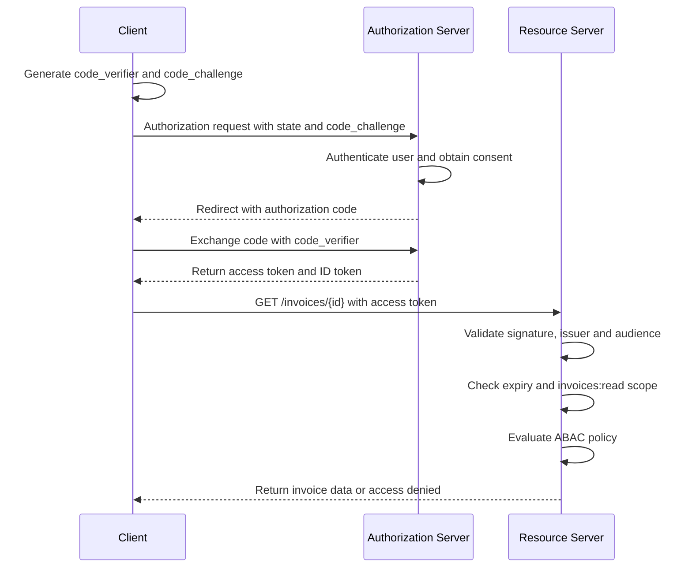

# OAuth 2.1 / OIDC Sequence Diagram

## 1. Participants

- Client — starts the authorization process.
- Authorization Server — authenticates the user and issues tokens.
- Resource Server — validates tokens and protects API resources.

## 2. Sequence Diagram

## 3. Explanation

The client starts the authorization process and generates PKCE values. The authorization server authenticates the user and returns an authorization code. The client exchanges this code for tokens using the code_verifier. Finally, the client sends the access token to the resource server, which validates the token, checks permissions and applies ABAC rules before returning invoice data.
